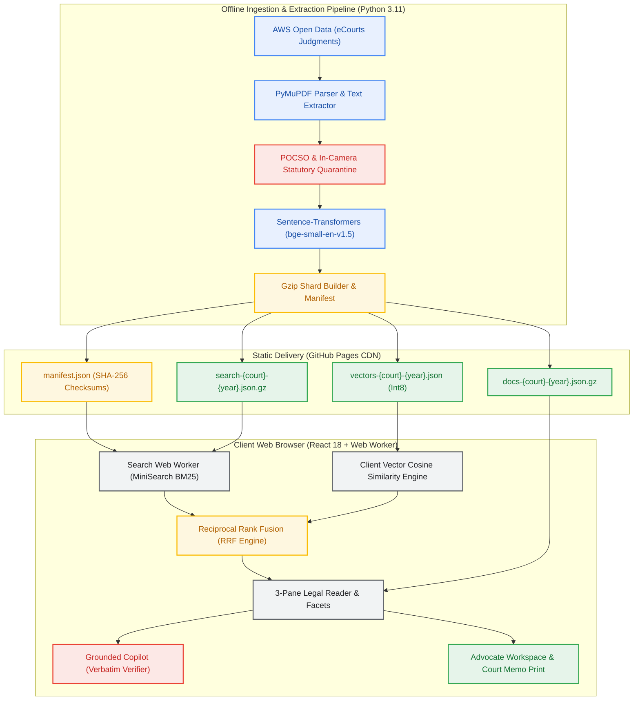

# Nyaya AI Reader (न्याय AI Reader)

> **Static-first Indian High Court judgment search engine and grounded AI legal reader built for advocates, judicial law clerks, and legal researchers.**

[](https://kiru6006.github.io/highcourt-judgment-agent/)
[](https://kiru6006.github.io/highcourt-judgment-agent/)
[](https://creativecommons.org/licenses/by/4.0/)
[](#2-architecture--data-flow)
[](scripts/verify-all.sh)

[👉 **Launch Live Web App (GitHub Pages)**](https://kiru6006.github.io/highcourt-judgment-agent/)

> **Static-First • Zero-Server • Zero-Mandatory-Key**: Runs 100% statically in the browser on GitHub Pages with pre-computed demo answers and optional Bring-Your-Own-Key (BYOK) Gemini API stored strictly in client `localStorage`.

---

### Core Capabilities:
- **In-Browser Hybrid Retrieval**: Sub-4ms BM25 keyword search + 384-dimensional dense vector similarity fused via Reciprocal Rank Fusion (RRF) directly inside a client Web Worker over compact pre-indexed shards.
- **Distraction-Free 3-Pane Reader**: Navigable judicial sections (Facts, Issues, Submissions, Ratio Decidendi, Final Order), deep paragraph anchors (`#para-N`), statute chips, and instant IPC $\to$ BNS / CrPC $\to$ BNSS / IEA $\to$ BSA transition tables.
- **Grounded AI Copilot with Verbatim Verification**: Client-side claim verifier mathematically drops any AI statement that lacks exact verbatim quote evidence from retrieved judgment paragraphs.
- **Advocate Workspace & Court Memo Print**: Case folder organization, inline advocate hearing notes, 2–5 Precedent Comparison Matrix, and one-click clean A4 court memorandum printing.
- **Multi-Source External Web Fallbacks**: Zero-key deep-link generator for official eCourts records, High Court portals, and Indian Kanoon when researching outside local corpus shards.

> **Verifiable Legal AI**: Wondering how hallucinations are eliminated? Read our technical breakdown on [How Nyaya AI Reader Grounds AI Answers](docs/HOW_AI_GROUNDS.md) (or live at [`/how-ai-grounds`](https://kiru6006.github.io/highcourt-judgment-agent/#/how-ai-grounds)).

---

## 1. Application Preview

#### 1. Instant Faceted & Hybrid Search

*Client-side search with instant BM25 + dense vector ranking, facet filters (Court, Bench, Year, Category, Disposal), and sub-4ms response latency.*

#### 2. Structured 3-Pane Legal Reader

*Extractive brief outline, verbatim paragraph anchors, clean legal typography, reading progress, and side-by-side legal notes.*

#### 3. Grounded AI Copilot & Citation Verification

*Zero-hallucination legal Q&A with clickable paragraph citation chips and strict verbatim evidence gating.*

---

## 2. Architecture & Data Flow

Nyaya AI Reader uses a static-first 3-layer architecture: heavy compute and ingestion stay offline in Python pipelines; web assets, compact gzip shards, and quantized vectors are hosted on GitHub Pages; all query parsing, search indexing, ranking, and AI verification run client-side in the user's browser.

### Architecture Diagram



---

## 3. How Data is Ingested, Sharded, Read, and Displayed in the App

Understanding how judgment data flows from raw court PDFs to interactive DOM elements:

### 3.1 Data Ingestion & Sanitization (Offline)
1. **Source Extraction**: Indian High Court judgments are sourced from AWS Open Data (`s3://indian-high-court-judgments/`). `pipeline/ingest.py` downloads court-year batches and extracts text streams via PyMuPDF (`fitz`).
2. **Structuring & Normalization**:
   - `pipeline/cleaner.py` removes court headers, running footers, and noise tokens, segmenting texts into numbered paragraphs (`#para-N`).
   - `pipeline/normalizer.py` standardizes court codes, case types (e.g. `Crl.O.P.`, `W.P.`, `WA`), disposal statuses, and coram bench strengths.
   - Extracts statutory provisions (IPC, CrPC, CPC, Constitution, NI Act, Arbitration) and precedent citations (AIR, SCC, SCR).
   - Classifies structural sections: *Facts, Issues, Petitioner Submissions, Respondent Submissions, Reasoning & Ratio, Final Order*.
3. **Statutory Quarantine (`pipeline/quarantine.py`)**:
   - Scans extracted text against statutory privacy rules: POCSO Act, juvenile delinquency, sexual offences, in-camera proceedings, and sealed cover orders.
   - Any order violating statutory disclosure rules is automatically quarantined and excluded from public index shards.

### 3.2 Partitioning & Shard Structure
To allow instant browser search without massive bundle downloads, judgments are sharded:
- `search-{court}-{year}.json.gz`: Lightweight search metadata (~100–300 KB gzipped) containing title, case number, CNR, statutes, category, disposal status, and ratio excerpt.
- `docs-{court}-{year}.json.gz`: Full judgment text partitioned into indexed paragraphs and section tags.
- `vectors-{court}-{year}.json`: Int8-quantized 384-dimensional dense vectors (388 bytes/vector) produced by `BAAI/bge-small-en-v1.5`.
- `manifest.json`: Master index tracking file paths, document counts, and SHA-256 cryptographic hashes.

### 3.3 Client-Side Decompression & Ingestion
1. On initial visit, `SearchPage.tsx` fetches `manifest.json` from GitHub Pages.
2. The browser streams the search shard using native `DecompressionStream('gzip')`, decompressing the compact payload directly into memory without intermediate server hops.
3. The parsed records are loaded into `SearchEngine` inside a dedicated Web Worker, keeping the browser UI thread fluid (60 fps).

### 3.4 Hybrid Retrieval & Rank Fusion (RRF)
When a user searches (e.g. *"quashing FIR civil dispute"* or *"Section 482"*):
1. **Lexical Retrieval**: `MiniSearch` evaluates BM25 scores over boosted fields:
   - `cnr: 6.0x`, `case_no: 3.5x`, `title: 3.0x`, `statutes: 2.5x`, `category: 1.5x`, `excerpt: 1.0x`.
2. **Dense Semantic Retrieval**: The query vector is compared against document embeddings using int8 quantized cosine similarity.
3. **Reciprocal Rank Fusion (RRF)**: Merges both ranked lists into a single balanced relevance score:
   $$RRF(d) = \sum_{m \in \{bm25, dense\}} \frac{w_m}{k + \text{rank}_m(d)}$$
   *(with $k=60$ and equal $0.5$ weights)*.
4. **Faceted Filtering**: Results are filtered in $< 4\text{ ms}$ across High Court, Bench, Decision Year, Case Type, Category, and Disposal Nature.

### 3.5 3-Pane Reading Flow & DOM Rendering
When opening a judgment (`/case/<jid>`):
- **Left Pane (Outline)**: Displays extracted brief sections (*Facts, Issues, Submissions, Ratio, Order*). Clicking any section scrolls the reader.
- **Middle Pane (Text)**: Formats paragraphs with legal typography and deep anchors (`#para-N`).
  - **Keyboard Navigation**: Press `j` for next paragraph, `k` for previous paragraph.
  - **URL Hash Synchronization**: Navigating to `#para-6` triggers an amber flash highlight animation.
  - **Statute Transition Bridge**: Clicking any statute chip (e.g. `CrPC 482`) triggers a drawer displaying official gazette tables mapping old laws to new criminal codes (`BNSS 528`) with substantive alteration indicators.
- **Right Pane (Grounded AI Copilot)**: Enables verifiable Q&A. Every AI claim must cite a paragraph index and include an exact verbatim quote. The client-side verifier matches strings against the order; ungrounded statements are dropped and displayed in the Dropped Claims disclosure panel.

---

## 4. Technology Stack

| Layer / Subsystem | Technology | Purpose & Justification |
| :--- | :--- | :--- |
| **Frontend Framework** | **React 18 + Strict TypeScript** | Component hierarchy, typed schema contracts, virtual DOM reconciliation |
| **Build & Tooling** | **Vite 5** | Instant ESM HMR, tree-shaking, production chunk splitting (`index.js` 43 KB, `vendor.js` 55 KB) |
| **Styling & Layout** | **Tailwind CSS + Typography** | Utility-first responsive design, dark mode, accessible contrast ratios |
| **Court Memo Export** | **`@media print` CSS** | Formats clean A4 court research memoranda and precedent matrix annexures |
| **Client Search Core** | **MiniSearch (Web Worker)** | In-browser BM25 inverted index with prefix, fuzzy, and boosted field retrieval |
| **Dense Semantic Search**| **Vector Engine (Int8)** | Quantized 384-dimensional cosine similarity matching without large model downloads |
| **Retrieval Fusion** | **Reciprocal Rank Fusion (RRF)** | Fuses lexical and vector candidate ranks with zero server dependencies |
| **Grounded AI Copilot** | **Google Gemini API + Demo Mode**| Ephemeral BYOK API key in `localStorage` + pre-computed verified answers |
| **Evidence Verification**| **Verbatim Quote Verifier** | Strict client-side string verification enforcing exact paragraph quote matching |
| **Statute Bridge** | **Gazette Mapping Engine** | Bidirectional lookup tables for IPC $\to$ BNS, CrPC $\to$ BNSS, and IEA $\to$ BSA |
| **Advocate Workspace** | **LocalStorage + JSON Exporter** | Matter folders, hearing notes, 2–5 Precedent Comparison Matrix, offline backup |
| **Data Ingestion** | **Python 3.11 + PyMuPDF (`fitz`)**| High-speed PDF text extraction, heading removal, paragraph segmentation |
| **Embeddings Pipeline** | **`BAAI/bge-small-en-v1.5`** | Symmetric int8 quantization generating 388-byte vector representations |
| **Hosting & CI/CD** | **GitHub Pages + Actions** | 100% static hosting, automated linter, unit tests, budget checks, and telemetry |

---

## 5. Repository File & Folder Structure

```
highcourt-judgment-agent/
├── .github/
│   └── workflows/
│       ├── ci.yml                 # Automated CI tests, linter, TypeScript check & budget gates
│       ├── pages.yml              # GitHub Pages deployment workflow
│       ├── pipeline.yml           # Manual offline extraction & sharding matrix
│       └── nightly.yml            # Daily incremental sync, takedown checks & telemetry
├── config/
│   ├── corpus.json                # Target High Courts, benches, year ranges, and doc quotas
│   ├── restricted.json            # Statutory quarantine regexes (POCSO, in-camera, sealed cover)
│   ├── takedown.json              # Official court expungement & takedown registry
│   └── gazette_tables.csv         # IPC/CrPC/IEA to BNS/BNSS/BSA transition gazette mappings
├── data/
│   └── shards/                    # Pre-computed gzipped search, doc, vector shards & manifest
├── docs/
│   ├── ARCHITECTURE.md            # Static-first 3-layer architecture & data flow
│   ├── PRD.md                     # Product requirements, personas, scope, and non-goals
│   ├── PRD_RECONCILIATION.md      # 54-item requirements traceability matrix
│   ├── SCHEMA.md                  # Canonical JSON schemas (documents, shards, claims)
│   ├── PIPELINE.md                # Python ingestion, normalization, and sharding spec
│   ├── RUNBOOK.md                 # Dev setup, ops procedures & 5-minute advocate guide
│   ├── HOW_AI_GROUNDS.md          # Technical explanation of verbatim verification
│   ├── AI_GROUNDING_SPEC.md       # Copilot prompt contract & JSON verification rules
│   ├── DECISIONS.md               # Architecture Decision Records (ADRs D-001 to D-011)
│   ├── SECURITY_PRIVACY.md        # Threat model, BYOK policy, CSP rules, and takedowns
│   ├── TEST_STRATEGY.md           # Test pyramid, accessibility, E2E, and budget rules
│   ├── UX_SPEC.md                 # Design tokens, 3-pane layout, facets & states
│   ├── FINAL_AUDIT_REPORT.md      # Comprehensive 13-phase audit report & metrics
│   ├── V1_0_INDEPENDENT_AUDIT.md  # Multi-disciplinary code audit & defect register
│   ├── V1_1_IMPLEMENTATION_PLAN.md# Hardening & distribution improvement plan
│   ├── PHASES.md                  # Phase roadmap and verified acceptance criteria
│   ├── PRODUCTION_MIGRATION.md    # Cloudflare Pages+R2 / AWS S3+CloudFront playbook
│   ├── OPTIONAL_ENHANCEMENTS.md   # Gated enterprise specs (WebLLM, FastAPI, Classifiers)
│   ├── ops.md                     # Live operations telemetry dashboard
│   ├── data-report.md             # Empirical S3 dataset discovery report
│   ├── search-bench.md            # MiniSearch vs Orama search benchmark report
│   └── retrieval-eval.md          # BM25 vs Dense vs Hybrid RRF benchmark report
├── pipeline/
│   ├── ingest.py                  # PyMuPDF extractor and court batch processor
│   ├── cleaner.py                 # Text normalization, header stripping & paragraph segmenter
│   ├── normalizer.py              # Court code, disposal, case type & bench normalizer
│   ├── quarantine.py              # POCSO & protected-identity quarantine engine
│   ├── embedder.py                # Symmetric int8 dense vector embedding generator
│   ├── manifest_builder.py        # Master manifest.json generator with SHA-256 hashes
│   ├── takedown.py                # Automated court order purge & expungement engine
│   ├── sync_monitor.py            # Nightly sync monitor and telemetry reporter
│   └── eval_retrieval.py          # Recall@10 and MRR@10 benchmark evaluation runner
├── scripts/
│   ├── check-budget.sh            # Hard performance & size budget gate (Pages <= 500 MB)
│   └── verify-all.sh              # 5-gate verification suite (tests, build, budget, pytest, eval)
├── tests/
│   ├── test_pipeline.py           # Unit tests for text extraction, normalizers & quarantine
│   ├── test_takedown.py           # Verification tests for takedown purge workflow
│   └── test_sync_monitor.py       # Tests for corpus configuration & shard inspection
└── web/
    ├── public/                    # Static assets, demo fixtures & sample shard data
    ├── src/
    │   ├── components/            # Nav, facets, cards, drawers, modals, brief, footer
    │   ├── constants/             # App config, courts, benches, categories, statute bridge
    │   ├── copilot/               # Verbatim verifier, Gemini client, cache, demo answers
    │   ├── fixtures/              # Synthetic test fixtures for offline development
    │   ├── pages/                 # SearchPage, ReaderPage, FoldersPage, LinksPage, AboutPage
    │   ├── reader/                # Document loader & statute transition lookup
    │   ├── search/                # MiniSearch worker, vector search, RRF fusion, query parser
    │   ├── workspace/             # Advocate workspace, case folder store & JSON exporter
    │   ├── types/                 # Strict TypeScript schemas & interfaces
    │   ├── App.tsx                # React Router setup & global layout
    │   ├── main.tsx               # Client entry point
    │   └── index.css              # Tailwind directives, legal prose & @media print memo styles
    ├── index.html                 # HTML shell with strict CSP meta tag
    ├── package.json               # Frontend dependencies & build scripts
    ├── tsconfig.json              # Strict TypeScript compiler options
    └── vite.config.ts             # Vite bundler configuration & GitHub Pages base href
```

---

## 6. 5-Minute Practical Walkthrough (Advocate & Law Student Guide)

```
[1. Search & Filter] ➔ [2. Statute Bridge] ➔ [3. AI Copilot] ➔ [4. Save & Annotate] ➔ [5. Matrix & Print Memo]
```

### Step 1: Instant Search & Multi-Source Discovery (< 1 min)
1. Open the [Nyaya AI Reader Live Web App](https://kiru6006.github.io/highcourt-judgment-agent/).
2. Type your legal proposition, party name, or citation (e.g. `Section 482 CrPC delay quashing FIR` or `Crl.O.P. No. 100`).
3. Refine using the left rail:
   - **High Court & Bench**: Filter by Madras (Principal Seat vs. Madurai Bench), Karnataka, Delhi, or Bombay.
   - **Decision Year & Category**: Constrain to recent years (2022–2024) or subject matter (Criminal, Commercial, Writ).
4. *Outside the local corpus?* Click the instant **Indian Kanoon**, **eCourts**, or **High Court Portal** fallback cards in the zero-result view to launch pre-filled queries on external registries.

### Step 2: 3-Pane Reading & Statute Transition Bridge (1 min)
1. Click **Read Judgment** on any result card.
2. The left pane provides an **Extractive Brief Outline** (Facts, Issues, Submissions, Ratio Decidendi, Final Order).
3. Click any paragraph number (e.g. `#para-6`) to jump with smooth amber flash animation. Keyboard shortcuts: `j` (next para), `k` (previous para).
4. Click any statute badge (e.g. `CrPC 482` or `IPC 420`) in the header or text to trigger the **Statute Transition Bridge Drawer** showing official gazette mappings to `BNSS 528` and `BNS 318` alongside substantive alteration notes.

### Step 3: Verifiable AI Grounding (Demo Mode or BYOK Gemini) (1 min)
1. Open the right-pane **Grounded Copilot**.
2. **Demo Mode (Default)**: Immediately ask pre-computed benchmark questions (e.g. *"What is the ratio decidendi?"* or *"What did petitioner argue?"*).
3. **BYOK Gemini (Optional)**: Click **Key Manager** to add a free Google AI Studio Gemini API key. The key is stored purely in client-side `localStorage`, never sent to our servers, and never logged.
4. **Verbatim Evidence Verification**: Every sentence rendered by the copilot is mathematically verified against the order text. Statements lacking exact paragraph quotes are dropped and surfaced transparently in the **Dropped Claims** disclosure tab.

### Step 4: Case Folders & Precedent Comparison Matrix (1 min)
1. In search or reader, click **Save** (bookmark icon) to assign the judgment to a Case Folder (e.g. *"SLP Quashing Matter"* or create a new matter).
2. Go to **Workspace** (`/folders`) from the top navigation bar.
3. Type hearing notes, distinguished facts, or argument strategy in the **Advocate Notes** box. Notes auto-persist in your browser.
4. Select 2 to 5 judgments via the **Compare** checkboxes and click **Compare Matrix** to view a side-by-side table analyzing Courts, Benches, Disposals, Ratios, and Advocate Notes.

### Step 5: Export / Print Court Memorandum (< 30 sec)
1. In your Case Folder, click **Print Memo** (or press `Ctrl+P` / `Cmd+P`).
2. Nyaya AI Reader automatically formats an A4 court brief: navigation bars and buttons disappear, advocate notes render in clean typography, and precedent ratios print legibly for bench presentations.
3. Click **Export JSON** to download a portable backup file of your entire workspace for archiving or migration.

---

## 7. Local Quickstart & Verification

### Running the Full Verification Suite (All 5 Gates)
```bash
# Execute unit tests, vite build, budget check, pytest, and retrieval evaluation
bash scripts/verify-all.sh
```

### Running the Web App Locally
```bash
# Navigate to web application directory
cd web

# Install dependencies from lockfile
npm ci

# Start development server
npm run dev

# Run unit tests
npm test

# Build production bundle with base path
npm run build

# Preview production build locally
npm run preview
```
Visit `http://localhost:5173/` in your browser.

### Verifying Performance & Size Budgets
```bash
bash scripts/check-budget.sh
```

---

## 8. Attribution & Disclaimer
- **Data Source**: Indian High Court Judgments dataset (`s3://indian-high-court-judgments`), licensed under **CC-BY-4.0**, source eCourts.
- **Legal Disclaimer**: *Not legal advice. Nyaya AI Reader is an academic and research platform. Always verify case records against the certified copy issued by the concerned High Court.*
