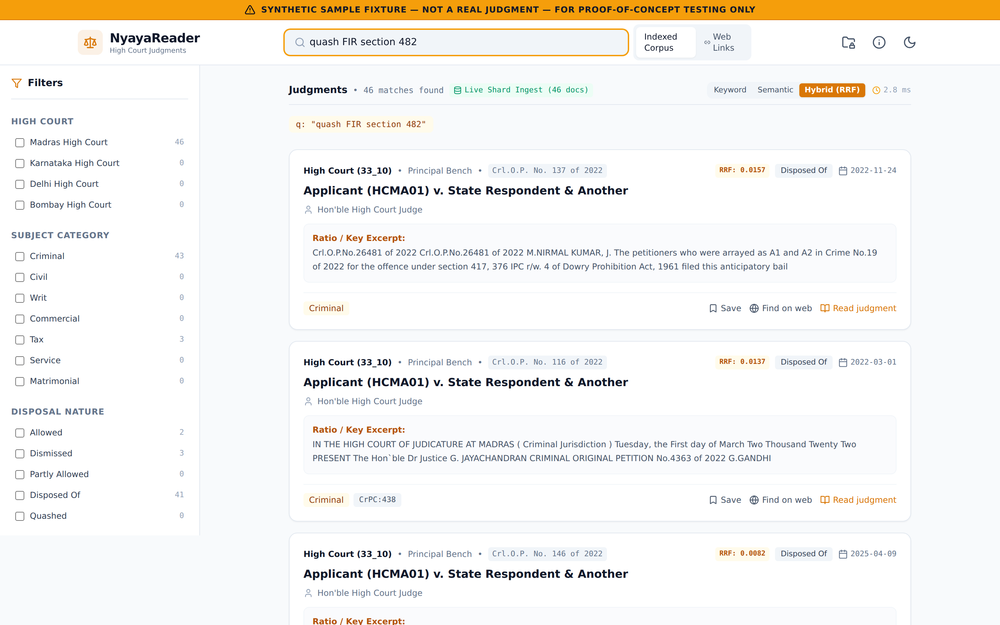
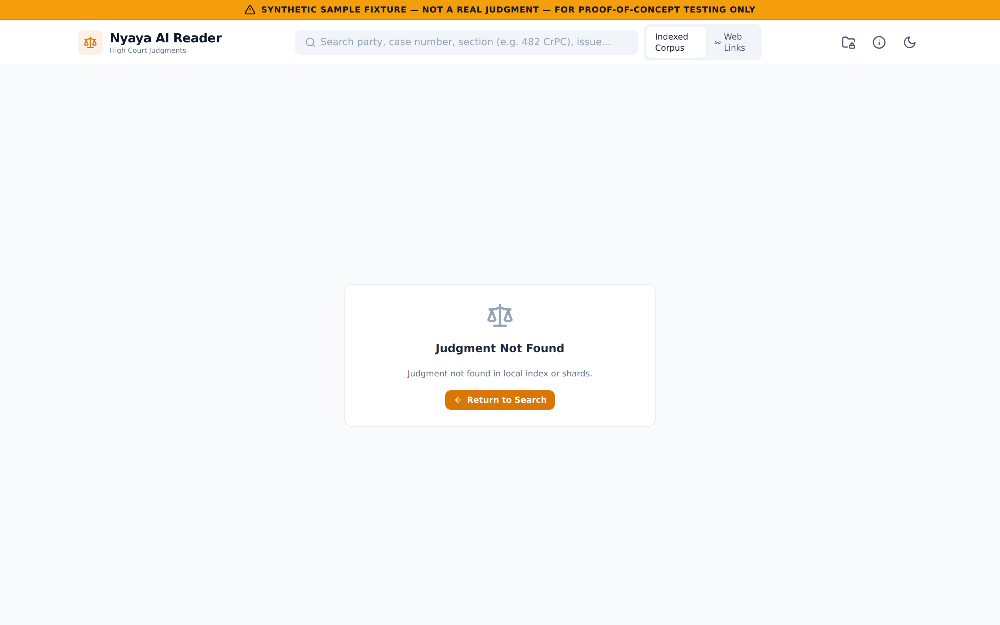

# NyayaReader (न्याय Reader)

> **Static-first Indian High Court judgment search engine and grounded AI legal reader built for advocates, clerks, and legal researchers.**

[](https://kiru6006.github.io/highcourt-judgment-agent/)
[](https://kiru6006.github.io/highcourt-judgment-agent/)
[](https://creativecommons.org/licenses/by/4.0/)
[](#3-technology-stack)
[](scripts/verify-all.sh)

[👉 **Launch Live Demo (GitHub Pages)**](https://kiru6006.github.io/highcourt-judgment-agent/)

> **Static-First • Zero-Server • Zero-Mandatory-Key**: Runs 100% statically in your browser on GitHub Pages with pre-computed demo answers and optional BYOK Gemini API key stored in local memory only.

---

### Core Capabilities:
- **In-Browser Hybrid Retrieval**: Sub-4ms BM25 keyword search + 384-dimensional dense vector similarity fused via Reciprocal Rank Fusion (RRF) directly inside a client Web Worker over compact pre-indexed shards.
- **Distraction-Free 3-Pane Reader**: Navigable judicial sections (Facts, Issues, Submissions, Ratio Decidendi, Final Order), deep paragraph anchors (`#para-N`), statute chips, and instant IPC $\to$ BNS / CrPC $\to$ BNSS / IEA $\to$ BSA transition tables.
- **Grounded AI Copilot with Verbatim Verification**: Client-side claim verifier mathematically drops any AI statement that lacks exact verbatim quote evidence from retrieved judgment paragraphs.

> **Verifiable Legal AI**: Wondering how hallucinations are eliminated? Read our technical breakdown on [How NyayaReader Grounds AI Answers](docs/HOW_AI_GROUNDS.md) (or live at [`/how-ai-grounds`](https://kiru6006.github.io/highcourt-judgment-agent/#/how-ai-grounds)).

---

### Application Preview

#### 1. Instant Faceted & Hybrid Search

*Client-side search with instant BM25 + dense vector ranking, facet filters (Court, Bench, Year, Category, Disposal), and sub-4ms response latency.*

#### 2. Structured 3-Pane Legal Reader

*Extractive brief outline, verbatim paragraph anchors, clean typography, reading progress, and side-by-side legal notes.*

#### 3. Grounded AI Copilot & Citation Verification

*Zero-hallucination legal Q&A with clickable paragraph citation chips and strict verbatim evidence gating.*

---

## 1. What is NyayaReader?
NyayaReader provides an open-access, distraction-free environment for Indian advocates, researchers, judicial law clerks, and students to search, analyze, and read High Court orders and judgments.

### Key Capabilities:
- **Clean 3-Pane Reader**: Outline navigation (Facts, Issues, Submissions, Ratio, Order), anchored paragraphs (`#para-N`), statute chips, and reading progress.
- **Client-Side Faceted Search**: High Court, Bench, Year, Case Type, Category, and Disposal status filtering executed in a Web Worker over compact pre-built shards.
- **Multi-Source Web Links**: Instant zero-key deep link generator for eCourts, High Court portals, and Indian Kanoon.
- **Grounded AI Legal Copilot**: Rigorous client-side evidence verification engine that drops any AI claim lacking verbatim paragraph quote support.
- **Statute Transition Bridge**: Instant reference mapping for IPC $\to$ BNS, CrPC $\to$ BNSS, and IEA $\to$ BSA based strictly on verified official gazette tables.
- **Advocate Workspace**: Case folder organization, inline advocate submissions/notes, and 2–5 Precedent Comparison Matrix.
- **100% Static Deployment**: Runs on GitHub Pages with zero required server infrastructure and zero mandatory API keys (Demo Mode pre-computed).

---

## 5-Minute Practical Walkthrough (Advocate & Law Student Guide)

Follow this quick guide to run real case research, precedent comparison, and argument preparation without configuring servers or paying for API keys:

```
[1. Search & Filter] ➔ [2. Statute Bridge] ➔ [3. AI Copilot] ➔ [4. Save & Annotate] ➔ [5. Matrix & Print Memo]
```

### Step 1: Instant Search & Multi-Source Discovery (< 1 min)
1. Open the [NyayaReader Live Web App](https://kiru6006.github.io/highcourt-judgment-agent/).
2. Type your legal proposition, party name, or citation (e.g. `Section 482 CrPC delay quashing FIR` or `Crl.O.P. No. 100`).
3. Refine using the left rail:
   - **High Court & Bench**: Filter by Madras (Principal Seat vs. Madurai Bench), Karnataka, Delhi, or Bombay.
   - **Decision Year & Category**: Constrain to recent years (2022–2024) or subject matter (Criminal, Commercial, Writ).
4. *Outside the local corpus?* Click the instant **Indian Kanoon**, **eCourts**, or **High Court Portal** fallback cards in the zero-result view to launch pre-filled queries on external registries.

### Step 2: 3-Pane Reading & Statute Transition Bridge (1 min)
1. Click **Read Judgment** on any result card.
2. The left pane provides an **Extractive Brief Outline** (Facts, Issues, Submissions, Ratio Decidendi, Final Order).
3. Click any paragraph number (e.g. `#para-6`) to jump with smooth amber flash animation. Keyboard shortcuts: `j` (next para), `k` (previous para).
4. Click any statute badge (e.g. `CrPC 482` or `IPC 420`) in the header or text to trigger the **Statute Transition Bridge Drawer** showing official gazette mappings to `BNSS 528` and `BNS 318` alongside substantive alteration notes.

### Step 3: Verifiable AI Grounding (Demo Mode or BYOK Gemini) (1 min)
1. Open the right-pane **Grounded Copilot**.
2. **Demo Mode (Default)**: Immediately ask pre-computed benchmark questions (e.g. *"What is the ratio decidendi?"* or *"What did petitioner argue?"*).
3. **BYOK Gemini (Optional)**: Click **Key Manager** to add a free Google AI Studio Gemini API key. The key is stored purely in client-side `localStorage`, never sent to our servers, and never logged.
4. **Verbatim Evidence Verification**: Every sentence rendered by the copilot is mathematically verified against the order text. Statements lacking exact paragraph quotes are dropped and surfaced transparently in the **Dropped Claims** disclosure tab.

### Step 4: Case Folders & Precedent Comparison Matrix (1 min)
1. In search or reader, click **Save** (bookmark icon) to assign the judgment to a Case Folder (e.g. *"SLP Quashing Matter"* or create a new matter).
2. Go to **Workspace** (`/folders`) from the top navigation bar.
3. Type hearing notes, distinguished facts, or argument strategy in the **Advocate Notes** box. Notes auto-persist in your browser.
4. Select 2 to 5 judgments via the **Compare** checkboxes and click **Compare Matrix** to view a side-by-side table analyzing Courts, Benches, Disposals, Ratios, and Advocate Notes.

### Step 5: Export / Print Court Memorandum (< 30 sec)
1. In your Case Folder, click **Print Memo** (or press `Ctrl+P` / `Cmd+P`).
2. NyayaReader automatically formats an A4 court brief: navigation bars and buttons disappear, advocate notes render in clean typography, and precedent ratios print legibly for bench presentations.
3. Click **Export JSON** to download a portable backup file of your entire workspace for archiving or migration.

---

## 2. Project Status & Roadmap

| Phase | Description | Status | Git Tag |
|---|---|---|---|
| **Phase 0** | Documentation baseline, architecture specifications, ADR log, and canonical schemas | **Completed** | `phase-0` |
| **Phase 1** | React 18 + Vite scaffold, CI/CD, Pages deploy, and synthetic fixture UI | **Completed** | `phase-1` |
| **Phase 2** | Empirical data spike (schema discovery, extraction quality, size model, CORS) | **Completed** | `phase-2` |
| **Phase 3** | Offline ingestion pipeline (PyMuPDF extraction, statutory quarantine, shard builder) | **Completed** | `phase-3` |
| **Phase 4** | Client search core (MiniSearch in Web Worker, shard loading, query parser) | **Completed** | `phase-4` |
| **Phase 5** | Real UI integration & Multi-Source Web Links mode | **Completed** | `phase-5` |
| **Phase 6** | 3-Pane Reader (outline, paragraph anchors, extractive structured briefs, statute bridge) | **Completed** | `phase-6` |
| **Phase 7** | Semantic search & hybrid retrieval (bge-small-en-v1.5 int8 in browser, RRF fusion) | **Completed** | `phase-7` |
| **Phase 8** | Grounded AI copilot (BYOK Gemini, verbatim claim verifier, Demo Mode answers) | **Completed** | `phase-8` |
| **Phase 9** | Advocate workspace (case folders, notes, precedent comparison matrix, print memo) | **Completed** | `phase-9` |
| **Phase 10** | Security, CSP enforcement, automated takedown engine, production migration playbook | **Completed** | `phase-10` |
| **Phase 11** | Nightly incremental sync workflow, declarative corpus config, and ops telemetry | **Completed** | `phase-11` |
| **Phase 12** | Optional enterprise enhancements documented & gated (WebLLM, FastAPI, Classifiers) | **Completed** | `v1.0.0` |

---

## 3. Technology Stack

- **Frontend**: React 18+ with Vite (Functional components, Hooks, React Router, Strict TypeScript).
- **Styling**: Tailwind CSS + Typography + `@media print` court memo layout.
- **UI Tooling**: Lucide Icons, Virtual Scroll (`@tanstack/react-virtual`).
- **Client Search**: Web Worker BM25 (MiniSearch) + int8 dense vector similarity + Reciprocal Rank Fusion (RRF).
- **Data Ingestion**: Python 3.11 (PyMuPDF text extraction, POCSO quarantine regex, gzip shard partitioning).
- **Embeddings & Indexing**: Python `sentence-transformers` (`BAAI/bge-small-en-v1.5` symmetric int8 quantization, 388 B/vec).
- **Deployment & CI**: GitHub Actions $\to$ GitHub Pages static hosting.

---

## 4. Documentation Index

The `docs/` directory contains complete architecture and technical specifications:
- [`docs/FINAL_AUDIT_REPORT.md`](docs/FINAL_AUDIT_REPORT.md): Comprehensive 13-phase audit and verification report.
- [`docs/PRD.md`](docs/PRD.md): Product requirements, personas, scope, and non-goals.
- [`docs/PRD_RECONCILIATION.md`](docs/PRD_RECONCILIATION.md): 54-item requirements traceability matrix and conflict analysis.
- [`docs/ARCHITECTURE.md`](docs/ARCHITECTURE.md): Static-first 3-layer architecture, data flow, and hosting options.
- [`docs/DECISIONS.md`](docs/DECISIONS.md): Architecture Decision Records (ADR D-001 through D-011).
- [`docs/SCHEMA.md`](docs/SCHEMA.md): Canonical data models (documents, paragraphs, shards, manifest, claims).
- [`docs/UX_SPEC.md`](docs/UX_SPEC.md): Design tokens, 3-pane layout, facets, responsive breakpoints, and states.
- [`docs/AI_GROUNDING_SPEC.md`](docs/AI_GROUNDING_SPEC.md): Prompt contract, structured JSON schema, and verbatim quote verifier.
- [`docs/SECURITY_PRIVACY.md`](docs/SECURITY_PRIVACY.md): Threat model, BYOK policy, CSP meta rules, and takedown workflow.
- [`docs/DATA_SOURCES_AND_LICENSING.md`](docs/DATA_SOURCES_AND_LICENSING.md): Dataset credit, CC-BY-4.0 attribution, and Copyright Act reliance.
- [`docs/TEST_STRATEGY.md`](docs/TEST_STRATEGY.md): Comprehensive test pyramid, E2E, accessibility, and budgets.
- [`docs/RUNBOOK.md`](docs/RUNBOOK.md): Local developer setup, data builds, deployment, and ops procedures.
- [`docs/PHASES.md`](docs/PHASES.md): Full phase roadmap and verified acceptance criteria.
- [`docs/PRODUCTION_MIGRATION.md`](docs/PRODUCTION_MIGRATION.md): Cloudflare Pages+R2 and AWS S3+CloudFront production migration guide.
- [`docs/OPTIONAL_ENHANCEMENTS.md`](docs/OPTIONAL_ENHANCEMENTS.md): Phase 12 gated specifications (WebLLM, FastAPI proxy, citation treatment).
- [`docs/ops.md`](docs/ops.md): Live operations dashboard, fleet capacity, and shard ledger.
- [`docs/data-report.md`](docs/data-report.md): Phase 2 empirical S3 data exploration findings.
- [`docs/search-bench.md`](docs/search-bench.md): Phase 4 MiniSearch vs. Orama benchmark report.
- [`docs/retrieval-eval.md`](docs/retrieval-eval.md): Phase 7 dense, lexical, and hybrid RRF retrieval evaluation benchmark.

---

## 5. Local Quickstart & Verification

### Running the Full Verification Suite (All 5 Gates)
```bash
# Execute unit tests, vite build, budget check, pytest, and retrieval evaluation
bash scripts/verify-all.sh
```

### Running the Web App Locally
```bash
# Navigate to web application directory
cd web

# Install dependencies from lockfile
npm ci

# Start development server
npm run dev

# Run unit tests
npm test

# Build production bundle with base path
npm run build

# Preview production build locally
npm run preview
```
Visit `http://localhost:5173/` in your browser.

### Verifying Performance & Size Budgets
```bash
bash scripts/check-budget.sh
```

---

## 6. Attribution & Disclaimer
- **Data Source**: Indian High Court Judgments dataset (`s3://indian-high-court-judgments`), licensed under **CC-BY-4.0**, source eCourts.
- **Legal Disclaimer**: *Not legal advice. NyayaReader is an academic and research platform. Always verify case records against the certified copy issued by the concerned High Court.*
