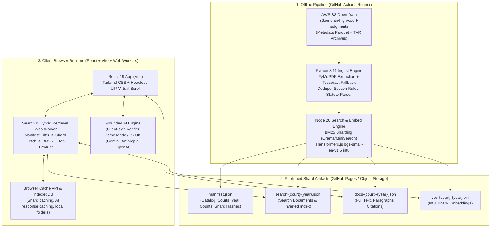

# Nyaya AI Reader — Architecture Specification

## 1. Static-First 3-Layer Architecture

Nyaya AI Reader operates strictly on a static-first, zero-server architecture designed for GitHub Pages hosting, delegating all compute-heavy extraction, indexing, and embedding workloads to GitHub Actions offline runners.



---

## 2. Component Breakdown & Data Flow

### 2.1 Layer 1: Offline Ingestion & Processing (GitHub Actions)
- **Environment**: Linux x86_64 runner, Python 3.11, Node.js 20.
- **Workflow Triggers**: Manual (`workflow_dispatch`), pilot setup, or scheduled incremental cron (`nightly.yml`).
- **Processing Steps**:
  1. Read upstream `STATS.md`, `court-codes.json`, and Parquet metadata anonymously via DuckDB/Boto3 from `s3://indian-high-court-judgments` (ap-south-1).
  2. Stream targeted TAR archives via index offsets without storing multi-gigabyte tar files on runner disks.
  3. Extract text using PyMuPDF; fall back to Tesseract OCR only if character density drops below verified thresholds.
  4. Generate stable JID hash: `sha1(cnr|decision_date|order_number)`.
  5. Apply deterministic section tagging rules (Facts, Issues, Submissions, Ratio, Order). Mark low-confidence sections as "Untagged".
  6. Extract statutory citations (IPC, CrPC, CPC, BNS, BNSS, BSA, Constitution) and precedent case citations.
  7. Filter records against `config/restricted.json` and `config/takedown.json`.
  8. Build court-year partition shards ($\le 25\text{ MB}$ uncompressed).
  9. Generate int8 embeddings via `transformers.js` (`BAAI/bge-small-en-v1.5`) and output separate `.bin` files.
  10. Emit `manifest.json` with SHA-256 checksums, court-year indices, and model metadata.

### 2.2 Layer 2: Published Artifacts Layout
Artifacts reside within the GitHub Pages build output under the base path:
```
web/dist/
├── index.html
├── assets/
├── data-sample/
│   ├── manifest.json
│   ├── search-33_10-2022.json.gz
│   ├── docs-33_10-2022.json.gz
│   └── vectors-33_10-2022.bin
```

### 2.3 Layer 3: Client Browser Execution
- **Zero Server Overhead**: The client loads static assets from GitHub Pages.
- **Institutional Legal Design System**:
  - Implements a dedicated legal palette (`legal-navy` `#0C1E3C`, `legal-brass` `#92400E`, `legal-parchment` `#FAF9F6`, `legal-ink` `#111827`, and `legal-outcome`).
  - Dual typography (`EB Garamond` for judicial prose, `Inter` for metadata & controls).
  - 72ch bounded reading measure for reduced cognitive strain.
  - 100% WCAG AAA compliant text contrast ($\ge 5.8:1$ across all secondary metadata, $\ge 12.6:1$ on body).
  - High Court paper-book print optimization (`@media print` stripping UI chrome and enforcing formal margins).
- **Web Worker Concurrency**:
  - `SearchWorker`: Loads `manifest.json`, evaluates active UI filters (court, year, bench, category), lazy-fetches only the required shard JSONs, executes BM25 search, computes real-time facet distributions, and returns paginated result cards.
  - `VectorEngine`: Lazy-loads compact `.bin` int8 quantized shards (388 B/vec) and computes dot-product similarity against active query embeddings.
  - `HybridSearch`: Reciprocal Rank Fusion combines BM25 keyword rankings with dense vector similarities.
- **Client Cache Strategy**:
  - Shard responses cached via browser in-memory LRU and Cache API.
  - Advocate case folders, notes, and AI response cache stored in `IndexedDB`/`localStorage`.

---

## 3. Hosting Options & Evaluation

| Option | Architecture | Browser CORS | Shard Range / Chunking | Cost | Status / Caveat |
|---|---|---|---|---|---|
| **A. Pages Artifact (Default)** | Static files deployed in same artifact as React app | **Zero CORS issues** (same-origin `data-sample/`) | Supported by GitHub Pages CDN | Free | **Primary Plan**: Hard cap $\le 500\text{ MB}$ (Pages limit 1 GB). |
| **B. Data Branch + jsDelivr** | Shards committed to separate orphan branch and served via jsDelivr CDN | Permissive CORS headers | Unreliable byte-range requests; 50 MB per-file limit | Free | **Rejected**: CDN rate limits and per-file caps risk breaking larger shards. |
| **C. GitHub Release Assets** | Shards uploaded as release assets | **Fails browser CORS** (browser cross-origin downloads blocked) | Redirects to AWS S3 without browser CORS headers | Free | **Rejected**: Unusable directly from web applications without proxy. |
| **D. Cloudflare R2 / AWS S3** | External object storage with public custom domain | Explicit CORS configuration (`Access-Control-Allow-Origin: *`) | Full HTTP Range request support | Negligible ($\sim \$0.015/\text{GB}$) | **Migration Target (Phase 10)**: Documented in `docs/PRODUCTION_MIGRATION.md` for scaling beyond 500 MB. |

*Verified: Phase 2 empirical spike validated same-origin Pages hosting (see `docs/data-report.md`). Phase 10 migration runbook established in `docs/PRODUCTION_MIGRATION.md`.*

---

## 4. Structured Case Intelligence Subsystem (v1.2.0)

NyayaReader v1.2.0 adds a deterministic case intelligence layer across offline ingestion and the static client runtime:

```
Shared Schemas & Registries:
  - shared/taxonomy/v1.ts: 8-domain legal hierarchy (taxonomyVersion: "1.0")
  - shared/court-codes/registry.ts: Verified official court code registry (Madras, Karnataka, Kerala, Delhi, Bombay)

Offline Ingestion & Auditing:
  - pipeline/classify/level1.py: Deterministic metadata & registry case-type classifier
  - pipeline/classify/level2.py: 10 narrow rule-based subject classifiers with mandatory paragraph evidence
  - pipeline/classify/engine.py: Multi-tier orchestrator with Level 3 AI inference gated
  - pipeline/anomaly/engine.py: Ingest-time auditor (A01 Source, A02 Identity, A04 Quality, A05 Classification)
  - data/anomaly-review/review-state.yaml: Version-controlled audit review state
  - data/anomaly-summary.json: Pre-computed ingest quality summary

Web Client Integration:
  - web/src/components/CaseIntelligencePanel.tsx: 3-pane reader panel (Stated vs. Inferred with paragraph anchors vs. Unknown)
  - web/src/components/LeftRailFacets.tsx: Live filter coverage indicators with automatic < 5% advanced toggle
  - web/src/utils/web-links.ts: Zero-guessing external portal deep links (eCourts, High Court Portals, Indian Kanoon)
  - web/src/pages/DataQualityPage.tsx: Read-only data quality dashboard with client-side JSON/CSV export
```
