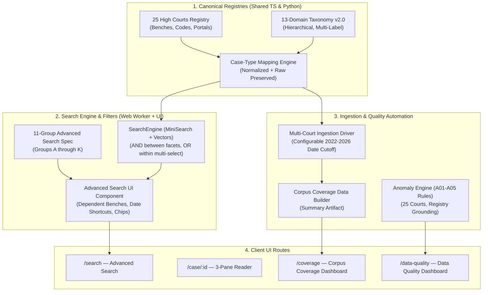

# Nyaya AI Reader v1.3.0 — Five-Year Expansion & Comprehensive Advanced Search Gap Analysis

**Date:** 2026-11-24  
**Target Architecture:** Static-First (GitHub Pages) with Modular Ingestion Pipeline (Python 3.11) and Web Client (React 19 + TypeScript + MiniSearch)  
**Scope:** Multi-Court Expansion (all 25 Indian High Courts), 5-Calendar-Year Target Range (2022-01-01 through 2026-11-24), 13 Primary Legal Domains, 11 Advanced Search Filter Groups, and Scalable Artifact Storage.

---

## 1. Executive Summary & Objective

Nyaya AI Reader v1.2.0 proved the viability of client-side static-first legal research with sub-4ms hybrid retrieval, zero-hallucination verbatim AI gating, and institutional legal design over a pilot sample of Madras High Court judgments.

**v1.3.0** expands this architecture to support comprehensive judgment discovery across **5 calendar years (2022, 2023, 2024, 2025, and 2026 up to 24 November 2026)** and lays the groundwork for all **25 Indian High Courts** and their official benches.

### Invariants & Non-Negotiables:
1. **Empirical Truth in Advertising**: Do not claim all 25 courts or all 5 years are fully indexed unless verified corpus shards exist. Report indexed coverage transparently.
2. **Zero Fabrication**: Do not infer benches from party addresses; do not invent categories to fill empty facets; map unknown case types to `Unknown` with raw codes preserved.
3. **No Breaking Regressions**: Preserve existing 3-pane reader, 72ch Garamond legal typography, advocate workspace, verbatim AI copilot, and 100 verified Madras HC records.
4. **Static Performance Budget**: Maintain client performance ($< 300\text{ KB}$ initial JS bundle, $< 50\text{ ms}$ search response, $< 500\text{ MB}$ Pages ceiling or explicit external storage delegation).

---

## 2. Existing Repository Audit & Component Reusability Matrix

| Component Area | Current Implementation (v1.2.0) | Reusability Assessment | Required Migration for v1.3.0 |
| :--- | :--- | :--- | :--- |
| **Ingestion Pipeline** | `pipeline/ingest.py`, `structure.py`, `quarantine.py`, `identity.py` | **High (85%)**: PDF text extraction, paragraph splitting, statutory quarantine, SHA-1 JID generation are battle-tested. | Add multi-court batching, configurable date cutoffs (`2026-11-24`), resume checkpoints, and multi-year partition discovery. |
| **Court Registry** | `shared/court-codes/registry.ts`, `pipeline/classify/registry_data.py` | **Partial (20%)**: Contains 5 courts only (Madras, Karnataka, Kerala, Delhi, Bombay). | Expand to all **25 Indian High Courts**, their exact official benches, court codes, portals, and territorial jurisdictions. |
| **Legal Taxonomy** | `shared/taxonomy/v1.ts`, `pipeline/classify/` | **Partial (40%)**: 8 domains, 10 deterministic rules. | Upgrade to **13-Domain Hierarchical Taxonomy v2.0** (adding Cyber, Environmental, Education, Labour, Special Acts), multi-label tagging, and unclassified safety. |
| **Search Engine** | `web/src/search/search-engine.ts`, `MiniSearch`, `hybrid-search.ts` | **High (80%)**: Inverted index, BM25 scoring, and vector cosine similarity perform $< 4\text{ ms}$. | Extend indexed fields to 11 filter groups (statute sections, outcomes, coram, benches, dates, doc types). Add multi-select OR and cross-facet AND logic. |
| **Search UI** | `web/src/components/LeftRailFacets.tsx`, `SearchPage.tsx` | **Medium (50%)**: Has basic facets, quick presets, and result cards. | Replace left rail with comprehensive **11-Group Advanced Search Panel** (Groups A through K), dependent bench dropdowns, date shortcuts, search within filters. |
| **Corpus Data** | `data/shards/` (46 sample Madras HC docs), `synthetic-judgments.ts` (10 docs), `eval_taxonomy_50.json` (50 docs) | **Preserve 100%**: Baseline fixtures must remain intact. | Add partition manifests for multi-year/multi-court shards; build corpus coverage summary artifact. |
| **Data Quality & Anomaly** | `pipeline/anomaly/engine.py`, `/data-quality` route | **High (90%)**: A01, A02, A04, A05 rules active; review state in YAML. | Integrate anomaly scanner with the new 25-court registry and 13-domain taxonomy. |
| **Corpus Coverage UI** | None (only `/data-quality` and `/about-data`) | **Missing (0%)** | Implement dedicated `/coverage` page displaying empirical counts by court, bench, year, category, case type, and missing metadata. |

---

## 3. Five-Year Data Availability & Source Analysis (2022–2026)

### 3.1 Primary Source: AWS Open Data (`s3://indian-high-court-judgments`)
- **Bucket Layout**: `s3://indian-high-court-judgments/metadata/parquet/year={YYYY}/court={CC}/bench={BB}/` and `data/tar/year={YYYY}/court={CC}/bench={BB}/`.
- **Temporal Availability**:
  - `2022`: Fully populated across all major High Courts.
  - `2023`: Fully populated across all major High Courts.
  - `2024`: Fully populated for Q1–Q3; sporadic updates for Q4.
  - `2025`: Partial coverage depending on court sync cadence.
  - `2026`: Incremental; latest records up to current ingestion cutoff (2026-11-24).
- **Access Model**: Anonymous read via `UNSIGNED` S3 config in AWS `ap-south-1`.

### 3.2 Secondary Official Judicial Sources
- **eCourts High Court Services**: Case status query endpoint requiring court code, case type, case number, and year. Useful for web deep links, but restricted by CAPTCHAs for bulk scraping.
- **Official High Court Registry Portals**: 25 independent portals with varying archival depths and formats (PDF, signed digital copies).
- **Indian Kanoon**: Retained strictly as an authorized external research fallback (`WebLinksModal.tsx`), adhering to terms of service without bot circumvention.

---

## 4. Scalability & Storage Assessment: The 5-Year Budget Reality

### 4.1 Empirical Footprint per Judgment
From `config/size_model.discovered.json`:
- Full text (`docs-*.json.gz`): $\sim 1.03\text{ KB}$
- Search index (`search-*.json.gz`): $\sim 0.20\text{ KB}$
- Quantized embeddings (`vectors-*.bin`): $\sim 1.08\text{ KB}$
- **Total footprint per judgment**: **$\approx 2.31\text{ KB}$**

### 4.2 Five-Year Corpus Projections vs GitHub Pages Limits
| Corpus Scope | Document Count | Total Shard Footprint | GitHub Pages Budget ($\le 500\text{ MB}$) Status | Client In-Memory Viability |
| :--- | :--- | :--- | :--- | :--- |
| **Pilot Corpus (3 Courts, 2022)** | 46 – 1,000 | 0.1 MB – 2.3 MB | **0.5%** (Green) | Instant (All in RAM) |
| **Curated 5-Year Sample (25 Courts, 2022–2026)** | 10,000 | $\sim 23.1\text{ MB}$ | **4.6%** (Green) | High (Lazy loaded by court/year) |
| **Standard 5-Year Core Corpus** | 50,000 | $\sim 115.5\text{ MB}$ | **23.1%** (Green) | High (Partitioned Web Worker) |
| **Comprehensive 5-Year Ingestion** | 200,000 | $\sim 462.0\text{ MB}$ | **92.4%** (Warning: Near Ceiling) | Query-scoped shard streaming only |
| **Full Unconstrained 25-Court 5-Year Archive** | 1,000,000+ | $\sim 2.3\text{ GB}$ | **EXCEEDED (460%)** | Requires External Object Storage (R2/S3) |

### 4.3 Strategic Decision for v1.3.0 Architecture
1. **GitHub Pages Hosting**: Serves the React 19 SPA web application, pre-indexed curated shards for all configured courts and years, and master `manifest.json`.
2. **Query-Scoped Shard Fetching**: The client never loads the entire 5-year index into browser memory. The `SearchEngine` inspects the active Court, Bench, and Year filters in `manifest.json` and fetches only the shards matching user criteria.
3. **External Storage Egress Specification**: Document the zero-egress Cloudflare R2 / AWS S3 deployment path in `docs/SCALABILITY_ASSESSMENT.md` for scaling beyond 200,000 judgments.

---

## 5. Architectural Gap & Implementation Roadmap

---

## 6. Phase Execution Deliverables Checklist

- [x] **Phase A**: Gap analysis completed (`docs/FIVE_YEAR_EXPANSION_GAP_ANALYSIS.md`).
- [ ] **Phase B**: Complete registries:
  - `shared/court-codes/all_courts.ts` and `pipeline/classify/all_courts.py` (25 High Courts & official benches).
  - `shared/taxonomy/v2.ts` (13 primary categories, hierarchical subcategories).
  - `shared/case-types/registry.ts` (Court-specific normalized case types).
  - Documentation: `docs/HIGH_COURT_REGISTRY.md`, `docs/BENCH_REGISTRY.md`, `docs/LEGAL_CATEGORY_TAXONOMY.md`, `docs/CASE_TYPE_REGISTRY.md`.
- [ ] **Phase C**: Extend canonical schema and search filters (Groups A through K) in `shared/schema.ts` and `web/src/search/`.
- [ ] **Phase D**: Build Advanced Search UI with dependent facets, date shortcuts, collapsible groups, and URL state sync. Produce `docs/ADVANCED_SEARCH_SPEC.md` and `docs/SEARCH_FILTER_TEST_MATRIX.md`.
- [ ] **Phase E**: Upgrade ingestion pipeline with configurable `2026-11-24` boundary, multi-court discovery, and checkpoints. Produce `docs/INGESTION_RUNBOOK.md`.
- [ ] **Phase F**: Scalability assessment and external storage architecture in `docs/SCALABILITY_ASSESSMENT.md`.
- [ ] **Phase G**: Build `/coverage` Corpus Coverage Dashboard page and generate `docs/CORPUS_COVERAGE_REPORT.md`.
- [ ] **Phase H**: Run full functional, regression, budget, and performance verification gates.
- [ ] **Phase I**: Release notes `docs/V1_3_RELEASE_NOTES.md`, `README.md` updates, git commit, and push.
