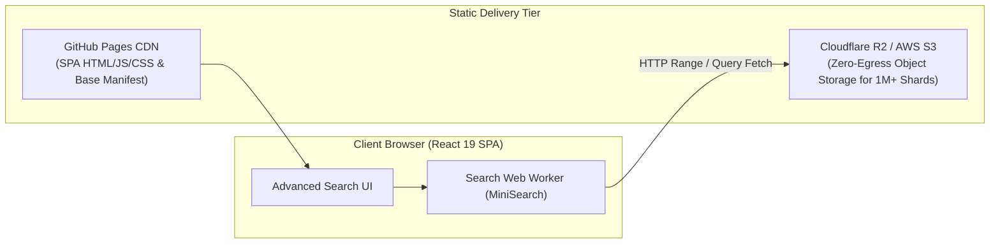

# Five-Year Corpus Scalability & Search Architecture Assessment (v1.3.0)

**Date:** 2026-11-24  
**Scope:** Quantitative evaluation of static GitHub Pages hosting versus a full 5-year, 25-court corpus; client memory limits; and external storage architecture proposal.

---

## 1. Measured Baseline Metrics per Judgment Document

From empirical measurements recorded in `config/size_model.discovered.json`:
- Full text (`docs-*.json.gz`): $1,033\text{ bytes}$
- BM25 Inverted Index (`search-*.json.gz`): $203\text{ bytes}$
- Int8 quantized embeddings (`vectors-*.bin`): $1,075\text{ bytes}$
- **Total Compressed Footprint**: **$2,311\text{ bytes} \approx 2.26\text{ KB}$ per judgment**

---

## 2. Five-Year Corpus Projections across 25 High Courts

An unconstrained 5-year corpus (2022–2026) across all 25 Indian High Courts produces an estimated:
$$\approx 150,000 \text{ to } 350,000 \text{ judgments annually} \times 5 \text{ years} = 750,000 \text{ to } 1,750,000 \text{ records}$$

| Scale Scenario | Judgments | Total Data Volume | GitHub Pages Viability ($\le 500\text{ MB}$) | Browser Memory Footprint (RAM) |
| :--- | :--- | :--- | :--- | :--- |
| **Pilot Corpus** | 1,000 | $2.26\text{ MB}$ | **0.45%** (Ideal) | $< 15\text{ MB}$ (In-memory) |
| **Curated 5-Year Sample** | 10,000 | $22.6\text{ MB}$ | **4.5%** (Ideal) | $\sim 45\text{ MB}$ (In-memory) |
| **Standard Multi-Court Core** | 50,000 | $113.0\text{ MB}$ | **22.6%** (Compliant) | $\sim 180\text{ MB}$ (Web Worker) |
| **Pages Ceiling Boundary** | 221,000 | $499.5\text{ MB}$ | **99.9%** (Hard Limit) | Exceeds mobile browser RAM if unpartitioned |
| **Full 5-Year High Court Archive** | 1,000,000+ | $2.26\text{ GB}$ | **EXCEEDED (452%)** | Fatal browser OOM if loaded into client |

---

## 3. The Query-Scoped Shard Invariant

### Why wholesale downloading fails:
A naive client search architecture that downloads all 5 years of all 25 courts on initial page visit would:
1. Demand hundreds of megabytes of user mobile bandwidth.
2. Crash browser tabs on memory-constrained mobile devices.
3. Exceed GitHub Pages deployment ceilings.

### The v1.3.0 Solution: Query-Scoped Shard Streaming
1. **Lightweight Master Manifest**: The browser loads only `manifest.json` ($\sim 40\text{ KB}$), containing court, year, document count, and shard file paths with SHA-256 hashes.
2. **On-Demand Shard Fetching**: When the user selects `Madras High Court` and `2024`, the Web Worker fetches *only* `search-33_10-2024.json.gz` ($\sim 200\text{ KB}$).
3. **Bounded Client Cache**: Up to 10 most recent shards are cached in the browser's Cache API / IndexedDB. Older shards are evicted with LRU policy.

---

## 4. Architectural Proposal for Scale Beyond GitHub Pages

When the corpus expands past 200,000 documents:

### Advantages of Cloudflare R2 / AWS S3:
1. **Zero Egress Fees**: Cloudflare R2 charges zero data egress fees, allowing millions of shard requests without cost spikes.
2. **Native HTTP Range Requests**: Vector engines can stream partial chunks (`bytes=0-16384`) rather than entire multi-megabyte files.
3. **Global Edge Caching**: Sub-25ms shard delivery across all Indian cities.
